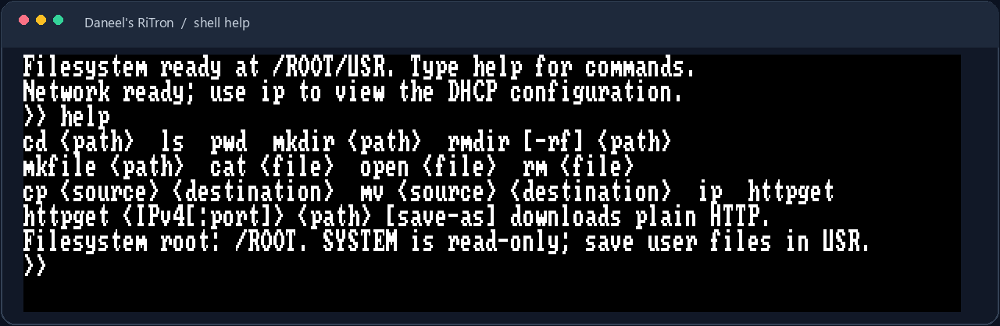
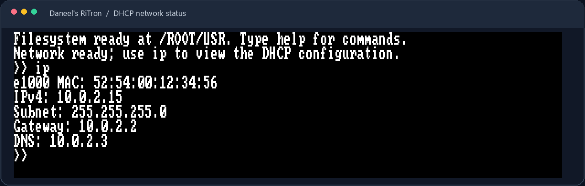

<div align="center">

# Daneel's RiTron

**A small x86_64 UEFI operating system, built to explore kernels, storage, and networking.**

<br>

**Kernel & networking**


**Build tools**


**Run & test**


<br>



*The kernel boots to its interactive shell in QEMU.*

</div>

---

Daneel's RiTron is an experimental operating system with a freestanding C++
kernel. It is an active learning project, currently tested with QEMU and a
narrow set of virtual devices—not a general-purpose OS.

## Get started

Build the EFI applications, bootable ISO, and persistent FAT16 data disk:

```sh
make iso disk
```

Run it with QEMU and OVMF firmware:

```sh
make qemu
```

See the [build and run guide](docs/BUILD.md) for toolchain setup, Docker builds,
and platform-specific details.

## What's inside

| Area | Highlights |
| --- | --- |
| **Boot and kernel** | UEFI boot flow, framebuffer console, interrupts, memory allocator, and PS/2 keyboard. |
| **Files and shell** | FAT16-backed virtual filesystem, editable text files, command history, and tab completion. |
| **Networking** | Intel e1000, DHCP, and a small Rust-based plain HTTP client. |
| **Build and verify** | Make-based build, bootable ISO, persistent data disk, and host-side disk checks. |

### Networking in QEMU

The `ip` command displays the adapter and DHCP configuration:



## Guides

| Guide | What you'll find |
| --- | --- |
| [Building and running](docs/BUILD.md) | Prerequisites, Linux and Windows setup, Docker, and QEMU. |
| [Kernel architecture](docs/ARCHITECTURE.md) | Boot handoff, source layout, and supported virtual hardware. |
| [Shell and filesystem](docs/FILESYSTEM.md) | Shell commands, editor controls, FAT16 layout, and storage behavior. |
| [Networking](docs/NETWORKING.md) | DHCP, the `httpget` command, a host-side test server, and limitations. |

## Data safety

The FAT16 disk at `build/data-disk.img` persists across runs. Back it up if it
contains files you need: `make clean` removes the entire `build/` directory,
including that disk.

For project standards and participation, see [Contributing](CONTRIBUTING.md),
[Code of Conduct](CODE_OF_CONDUCT.md), and [Security](SECURITY.md).
