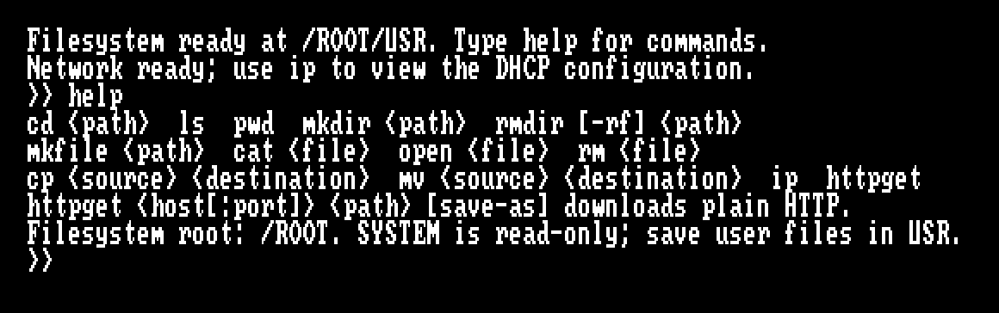
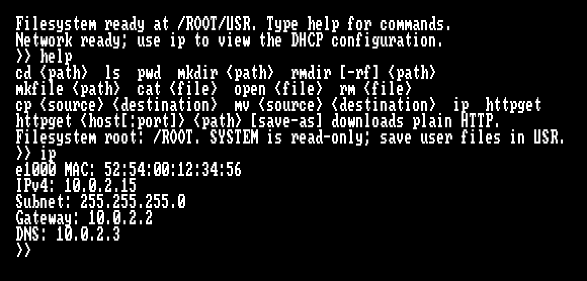
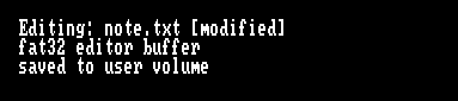
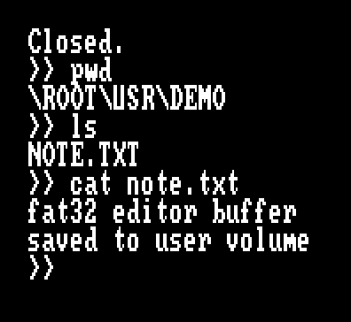
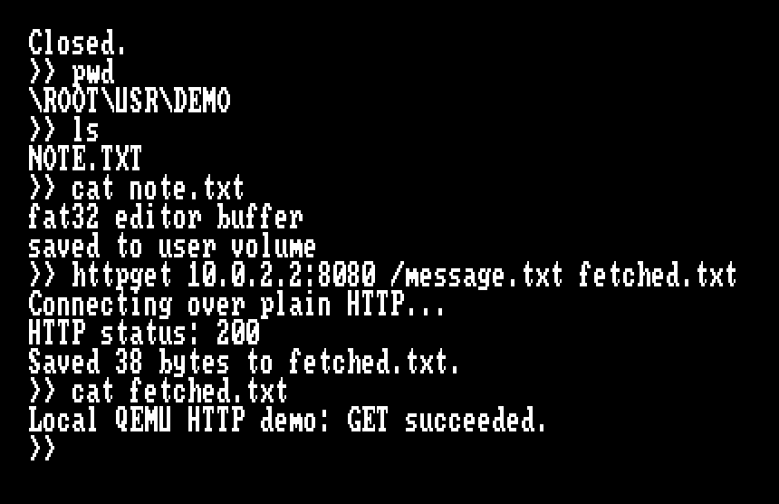

<div align="center">

# Daneel's RiTron

**A small x86_64 UEFI operating system for exploring kernels, storage, and networking.**

Boot it in QEMU, explore a persistent FAT32 disk from the shell, and inspect a
small synchronous HTTP client built into the kernel.

</div>

---

Daneel's RiTron is an experimental operating system with a freestanding C++
kernel and a small `no_std` Rust network client. It is designed to make the
boot path and low-level mechanisms understandable—not to be a general-purpose,
secure, or production-ready OS. QEMU is the primary supported test platform.

## See it running

These are cropped captures of the guest framebuffer from QEMU/OVMF, not
mockups. Active console regions were enlarged 2x with nearest-neighbor
scaling. The guest runs used a temporary copy of the data disk; the HTTP
capture also used a temporary host-side server.

| Shell help | DHCP configuration |
| --- | --- |
|  |  |

| Text editor | FAT32 file operations |
| --- | --- |
|  |  |

**HTTP client:** a guest request to a temporary host-side HTTP server returns
status 200, saves the body to FAT32, and reads it back.



The [user guide](docs/USER_GUIDE.md) maps each capture to its command sequence
and records the emulator configuration.

## Quick start

Install the build tools and QEMU/OVMF using the
[build and run guide](docs/BUILD.md), then from the repository root:

```sh
make iso disk
make qemu
```

The QEMU window opens to the shell. Start with:

```text
help
pwd
ls
ip
```

`make qemu` requires QEMU and OVMF on the host. The build alone does not boot
the OS; Docker can build and verify images, but does not run QEMU.

> [!WARNING]
> `build/data-disk.img` persists across runs and may contain your files.
> Back it up before `make clean`, which deletes the entire `build/` directory.

## Technical profile

| Subsystem | Contract in the current implementation |
| --- | --- |
| Firmware handoff | x86_64 UEFI PE/COFF images; the loader exits boot services and passes versioned `BOOT_INFO`. Physical addresses are used directly; no new page tables are installed. |
| Memory | 4 KiB pages; bitmap allocator manages physical addresses from 1 MiB up to (but not including) 4 GiB. Heap blocks are 16-byte aligned and first-fit. |
| Interrupts and input | 256-entry IDT, fail-stop exception handlers, legacy 8259 PIC and PIT at about 100 Hz; PS/2 set-1 keyboard events enter a 64-slot ring (63 usable entries). |
| Storage | Raw 64 MiB FAT32 volume at LBA 0, 512-byte sectors, one sector per cluster; legacy ATA PIO with 28-bit LBA. `/ROOT/USR` is writable; `/ROOT/SYSTEM` is protected. |
| Networking | PCI bus-0 e1000 with eight RX/TX descriptors; 1,514-byte frame cap. C++ owns NIC/DHCP; Rust `no_std` code implements ARP, IPv4, DNS A, bounded TCP, and plain HTTP/1.1 GET. |
| Shell/editor | 600-byte command buffer, eight history entries, four-token dispatch limit, and a statically allocated 65,536-byte editor buffer. Text is printable ASCII. |
| Validation | Host-side tests cover protocol helpers and FAT image creation/migration. They do not execute the kernel or establish physical-hardware compatibility. |

These are implementation limits, not generic PC capabilities. There is no
process isolation, scheduler, virtual-memory manager, SMP, TLS, or general
socket API. Networking is synchronous and single-request; HTTP traffic is
unencrypted. See the [architecture guide](docs/ARCHITECTURE.md),
[filesystem guide](docs/FILESYSTEM.md), and
[networking guide](docs/NETWORKING.md) for subsystem detail.

## Try the shell

At the `>> ` prompt, create and edit a user file:

```text
mkdir NOTES
open NOTES/HELLO.TXT
```

Type into the editor, press **Ctrl+S** to save, then **Ctrl+X** to return to the
shell. Verify the file with:

```text
cat NOTES/HELLO.TXT
```

The shell starts in `/ROOT/USR`. Its editor supports printable ASCII files up
to 64 KiB; see the [user guide](docs/USER_GUIDE.md) for keyboard controls,
path rules, and a local HTTP demo.

## Build and test

```sh
make             # Build EFI applications
make net-test     # Run host-side networking protocol tests
make disk-test    # Test disk image creation and migration
make iso disk     # Create boot media and persistent FAT32 disk
make verify      # Validate the data-disk image
make qemu         # Build and launch in QEMU/OVMF
```

The build produces `build/daneels-ritron.iso` and `build/data-disk.img`.
For Windows, Linux, and Docker setup, see [Building and running](docs/BUILD.md).

## Documentation

| Guide | Description |
| --- | --- |
| [User guide](docs/USER_GUIDE.md) | First boot, shell tour, editor keys, persistent files, and a local network demo. |
| [Build and run](docs/BUILD.md) | Toolchains, platform setup, Docker, Make targets, and validation scope. |
| [Architecture](docs/ARCHITECTURE.md) | UEFI handoff, memory, interrupts, hardware paths, and design limits. |
| [Filesystem](docs/FILESYSTEM.md) | FAT32 layout, shell commands, path rules, failure modes, and data safety. |
| [Networking](docs/NETWORKING.md) | DHCP, packet flow, TCP/HTTP behavior, limits, and reproducible tests. |

For project standards and participation, see [Contributing](CONTRIBUTING.md),
[Code of Conduct](CODE_OF_CONDUCT.md), and [Security](SECURITY.md).
