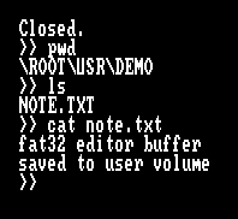

# Shell and FAT32 filesystem

**Guides:** [Home](../README.md) · [Build and run](BUILD.md) ·
[Architecture](ARCHITECTURE.md) · [Networking](NETWORKING.md)

## Volume layout and persistence

The QEMU data disk is a 64 MiB FAT32 image at `build/data-disk.img`. The shell
mounts it behind a virtual root:

```text
/ROOT/
  SYSTEM/    # BOOTX64.EFI and KERNEL.EFI; read-only through the shell
  USR/       # writable user files; initial working directory
```

`make disk` updates the system EFI files and preserves existing user data.
It migrates the former 16 MiB project FAT16 image to FAT32, checking the copied
directory tree and file contents before atomically replacing the old image.
The image is persistent across QEMU runs. Back it up before using `make clean`,
which removes the entire `build/` directory.

The filesystem supports printable ASCII long filenames up to 255 characters,
case-insensitive lookup, and FAT short-name aliases. The kernel supports
printable ASCII names and uses generated short aliases for directory
interoperability. The kernel and ATA probe accept FAT32 only; FAT16 is
used only for the compact UEFI El Torito boot image and the host updater's
one-time migration reader. The filesystem is not journaled.

## On-disk geometry

The host disk creator fixes the new FAT32 volume geometry. The image is a raw
sequence of 512-byte sectors with no partition table; the FAT volume begins at
LBA 0.

| Region | Sectors | Byte range / size |
| --- | ---: | ---: |
| Reserved area | 32 | LBAs 0–31; includes FSInfo (1) and backup boot/FSInfo (6–7) |
| FAT copies | 2 × 1,009 | LBAs 32–2,049; 1,033,216 bytes total |
| Data region | 129,022 clusters × 1 sector | Starts at LBA 2,050; 66,059,264 bytes |
| FAT32 root directory | Cluster 2 and its chain | Starts at LBA 2,050; grows as needed |

These values follow directly from the BPB fields:

```text
root_sectors = ceil(root_entry_count × 32 / bytes_per_sector)  # zero on FAT32
data_start   = reserved_sectors + FAT_count × FAT_sectors + root_sectors
cluster_count = floor((total_sectors - data_start) / sectors_per_cluster)
```

For the new image, `total_sectors = 131,072`, `bytes_per_sector = 512`,
`sectors_per_cluster = 1`, `reserved_sectors = 32`, `FAT_count = 2`,
`FAT_sectors = 1,009`, and `root_entry_count = 0`. Thus each data cluster is
512 bytes and there are 129,022 data clusters, within FAT32's cluster-count
range. Each FAT entry is a little-endian 32-bit value whose upper four bits
are reserved. The FAT type is inferred from BPB geometry and cluster count,
not the human-readable filesystem label.

The approximate data-region capacity is about 63 MiB before accounting for
directory entries, EFI files, and free-space fragmentation. FAT32's root
directory is cluster-backed and grows like a subdirectory; cluster chains may
be fragmented, so the driver follows FAT links rather than assuming extents
are contiguous.

The volume identity is part of the driver contract: the kernel ATA probe
accepts FAT32 BPB layouts with the `KERNELDATA ` label and volume ID
`0x44525446`. The host verifier checks the expected image size, geometry, FAT
capacity, matching FAT copies, reserved entries, and filesystem metadata.

## Name encoding, path resolution, and virtual root

FAT directory entries are 32 bytes. Printable ASCII long names are stored as
VFAT long-filename (LFN) entries in UTF-16 code units, followed by the regular
8.3 alias entry. The current implementation accepts ASCII printable
characters only, limits a name to 255 characters (at most 20 LFN entries,
each able to hold 13 UTF-16 code units), and compares names case-insensitively. It
does not implement Unicode normalization, arbitrary UTF-16 names, timestamps
as a user-facing feature, or a full host-style path namespace.

Path parsing accepts `/` and `\` separators. An absolute path begins from the
volume root; a relative path begins at the current directory. The kernel
places a virtual `/ROOT` above the on-disk directories and starts the shell in
`/ROOT/USR`. `/ROOT/SYSTEM` is protected from shell write/delete operations,
while `/ROOT/USR` is writable. The virtual root is a policy layer in the
filesystem code, not a separate partition or mount.

Directory navigation is bounded to 16 components in the current-directory
stack. Recursive deletion has a separate maximum depth of 32. Operations
return explicit result codes for cases such as invalid names, non-directories,
non-empty directories, insufficient space, corrupt chains, read-only paths,
and I/O failures. Directory scans validate cluster numbers and bound traversal
to detect loops or malformed chains instead of following them indefinitely.

## File replacement and failure model

File writes use a staged replacement sequence. The implementation allocates
and writes the replacement data chain first, flushes it, then publishes or
updates the directory entry, flushes that metadata, and only then releases
the old chain. This ordering is intended to keep the old directory entry
pointing to the previous contents until the replacement data has been
written. `cp` similarly duplicates and flushes data before publishing its new
entry. `mv` publishes the destination name before deleting the source name;
it is metadata-oriented but still requires multiple writes.

These sequences reduce some write-failure risks; they do not make FAT
transactional. FAT has no journal or copy-on-write root. A power loss can
occur between sector writes, and a disk/controller that lies about cache
flush completion can weaken ordering guarantees. A partially completed
operation may leak allocated clusters, leave both names after a move, or
damage metadata. There is no `fsck` implementation in the kernel. Keep an
external backup of data that matters.

The host-side `make disk` tool preserves user data when updating FAT32 images.
Its FAT16 reader exists only to migrate the former project image: it validates
and snapshots the directory tree, copies names and file bytes into FAT32,
verifies the copied tree, and then updates the system EFI files. It writes the
completed image beside the destination and replaces the old image only after
the staging write is flushed. Unexpected image sizes or volume identities are
rejected rather than overwritten.

## Shell commands

At the `>> ` prompt, use `help` to display the command list.

| Command | Description |
| --- | --- |
| `help` | Show available commands. |
| `ls` | List the current directory. |
| `pwd` | Print the current path. |
| `cd <path>` | Change directory; `cd ..` moves up and `cd /` returns to `/ROOT`. |
| `mkdir <path>` | Create a directory, including nested paths. |
| `rmdir <path>` | Remove an empty directory. |
| `rmdir -rf <path>` | Recursively remove a directory and its contents. |
| `mkfile <path>` | Create an empty file. |
| `cat <file>` | Print a text file (up to 64 KiB). |
| `open <file>` | Open a file in the text editor, or start a new unsaved file. |
| `cp <source> <destination>` | Copy a regular file to a new path. |
| `mv <source> <destination>` | Move or rename a regular file to a new path. |
| `rm <file>` | Remove a file. |
| `ip` | Show the e1000 MAC and DHCP network configuration. |
| `httpget <IPv4[:port]> <path> [save-as]` | Fetch plain HTTP and display or save the response. |
| `quit` | Request QEMU-compatible poweroff. |



*The shell starts in `/ROOT/USR`; use `help` to see the available commands.*

Paths may be relative or absolute and accept `/` or `\` separators. Quote
arguments containing spaces:

```text
mkdir NOTES
open "NOTES/TODO LIST.TXT"
cat "NOTES/TODO LIST.TXT"
cp "NOTES/TODO LIST.TXT" "TODO BACKUP.TXT"
```

`cp` and `mv` operate on regular files and refuse to overwrite existing
entries. The shell supports Up/Down command history (eight recent commands),
cursor movement and editing, and Tab completion for commands and names in the
current directory. Input is limited to 599 characters.

## Text editor

The editor supports printable ASCII text and files up to 64 KiB. Enter adds a
newline; Backspace/Delete remove text; arrow keys move the cursor; Home and End
move to the line boundaries. CRLF and CR endings are normalized to LF when
opening a file.

- **Ctrl+S** saves the file.
- **Ctrl+X** closes the editor and discards unsaved changes.
- **Tab** inserts a tab.

Files in `/ROOT/SYSTEM` cannot be edited or saved.

## Storage behavior and limitations

Replacing a file stages and flushes its new contents and FAT chain before
switching the directory entry, then releases the old chain. A move creates and
flushes the destination before removing the source. These orderings reduce the
chance of losing file contents on write failures, but FAT has no journal:
power loss during a metadata update can still leave orphaned clusters or
damaged metadata.

`rmdir -rf` permanently removes the named directory and contents from the
virtual disk; it refuses to remove `/ROOT`, `/ROOT/SYSTEM`, or the current
directory and its parents. The data disk has finite capacity, and ATA support
is currently limited to the project's legacy 28-bit LBA PIO disk.

The editor uses one statically allocated 65,536-byte buffer, accepts printable
ASCII text, and stores line endings as LF. On open, CRLF and CR sequences are
normalized to LF. Saving writes the current byte buffer; it does not preserve
the original newline convention. The shell's command input buffer is 600
bytes including the terminator (599 input characters maximum), and its
eight-entry history suppresses only adjacent duplicate commands.
