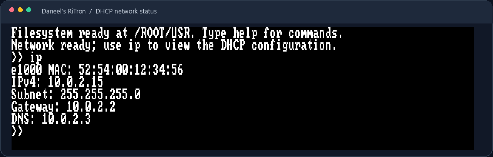

# Networking

**Guides:** [Home](../README.md) · [Build and run](BUILD.md) ·
[Architecture](ARCHITECTURE.md) · [Shell and filesystem](FILESYSTEM.md)

## Current support

In QEMU, the kernel initializes the Intel e1000 virtual adapter and attempts
DHCP. QEMU user-mode networking typically assigns `10.0.2.15`, with gateway
`10.0.2.2` and DNS server `10.0.2.3`; use the shell's `ip` command to see the
actual configuration and MAC address.



*Example QEMU user-mode network configuration; addresses may differ.*

The Rust client implements ARP, IPv4, a synchronous TCP connection, and plain
HTTP/1.0 GET to a numeric IPv4 address. It can print a response or save a
successful response (up to 64 KiB) to the FAT16 filesystem.

```text
httpget 10.0.2.2:8080 / index.html
cat index.html
```

This example requests `/` from an HTTP server listening on the host at port
8080 and saves the response in the current OS directory. Start a test server
on the host, from the directory you want served:

```sh
python3 -m http.server 8080 --bind 0.0.0.0
```

On Windows, use `python` instead of `python3` if that is the installed command.
Keep the server running while issuing `httpget` in QEMU.

## Limitations

This is an early, single-connection client, not a complete TCP/IP stack. It
does not support DNS names, HTTPS/TLS, IPv6, general-purpose TCP congestion
control, or out-of-order/retransmitted stream reassembly. It is designed for
the QEMU e1000 and user-mode network setup, not arbitrary physical adapters.
HTTP is unencrypted: do not send credentials or private data through it.

## Implementation

The C++ e1000 driver owns PCI discovery, descriptor rings, frame I/O, and DHCP.
The Rust networking module calls its narrow C ABI to exchange Ethernet frames.
The shell routes `httpget` requests through that Rust module and can pass a
successful response to the FAT16 writer. See
[kernel architecture](ARCHITECTURE.md) for the source layout.
