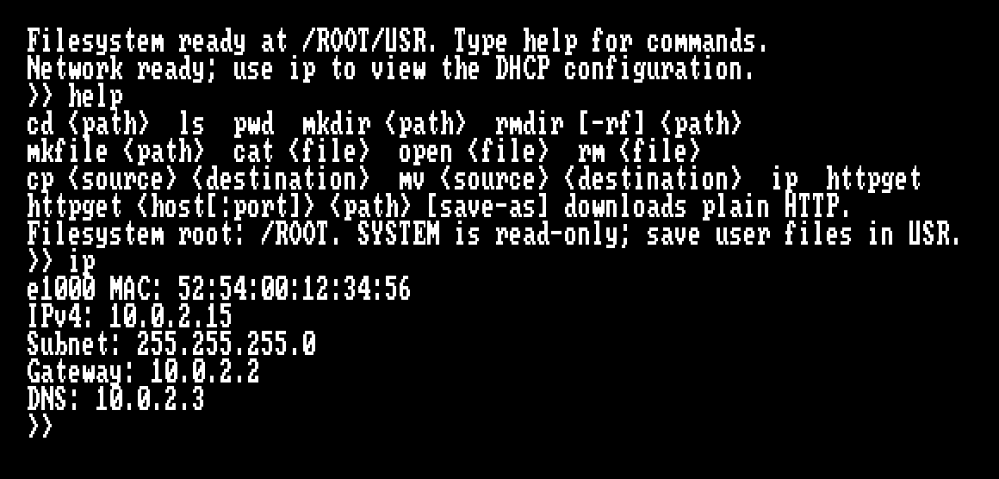
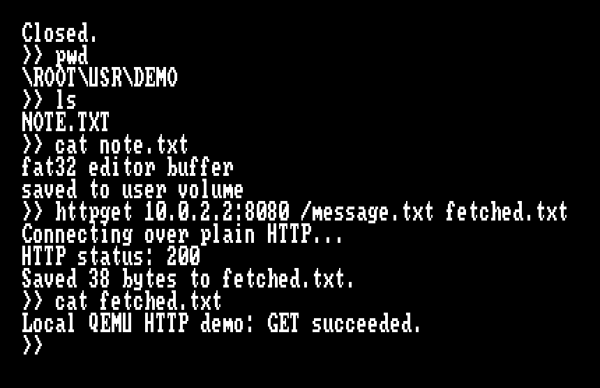

# Networking

**Guides:** [Home](../README.md) · [Build and run](BUILD.md) ·
[Architecture](ARCHITECTURE.md) · [Shell and filesystem](FILESYSTEM.md)

## Current support

In QEMU, the kernel initializes the Intel e1000 virtual adapter and attempts
DHCP. QEMU user-mode networking typically assigns `10.0.2.15`, with gateway
`10.0.2.2` and DNS server `10.0.2.3`; use the shell's `ip` command to see the
actual configuration and MAC address.



*Example QEMU user-mode network configuration; addresses may differ.*

The networking path has two ownership layers:

```text
shell (C++) -> HTTP client (Rust, no_std) -> e1000 frame API (C++)
                                          -> descriptor rings -> virtual NIC
```

The C++ e1000 driver owns PCI discovery, MMIO registers, DMA descriptors,
Ethernet transmission/reception, and DHCP. The Rust client owns ARP resolution
and caching, IPv4/UDP/TCP packet construction and validation, DNS queries, and
HTTP request/response handling. The boundary consists of synchronous C ABI
calls for copying the network configuration and sending or receiving one
complete Ethernet frame.
The NIC driver copies transmitted bytes into its static descriptor buffer
before returning, so Rust's temporary packet storage does not outlive the call.

## Address configuration: DHCP

After NIC initialization the driver performs a bounded DHCP exchange using
Ethernet broadcast, IPv4, UDP, and BOOTP/DHCP:

```text
client UDP 68 -> server UDP 67: DISCOVER
server UDP 67 -> client UDP 68: OFFER
client UDP 68 -> server UDP 67: REQUEST
server UDP 67 -> client UDP 68: ACK (or NAK)
```

The driver matches replies using the transaction identifier and client MAC,
checks nested Ethernet/IP/UDP/BOOTP lengths before parsing options, and
extracts the offered address, subnet mask, router, DNS server, server
identifier, and lease duration. It tries the discover/request exchange at
most three times. DHCP is an initial configuration step only: lease renewal,
rebinding, release, and static configuration are not implemented. The DNS
address is consumed by the Rust client for hostname lookups.

The kernel's PIT runs at approximately 100 Hz, and the shared stall routine
rounds requested delays up to a timer tick. DHCP and network wait loops use
bounded tick/iteration budgets, so wall-clock time is approximate and depends
on the emulator and the number of frames processed.

| Operation | Bound in code | Approximate interpretation |
| --- | ---: | --- |
| DHCP wait for one expected reply | 200 iterations; up to 3 exchanges | Each empty iteration requests a 10 ms stall; a full discover/offer/request/ack attempt can therefore consume two reply windows. |
| ARP resolution | 300 iterations | About 3 seconds when each iteration reaches its 10 ms stall. |
| DNS lookup | 300 iterations; retransmit every 100 | About 3 seconds, with a query retry after each second. |
| TCP handshake | Up to 3 attempts × 100 receive iterations | About 1 second per attempt without a matching response. |
| HTTP response wait | 1,000 receive-loop iterations | About 10 seconds when no matching frames arrive; it is an iteration budget, not a wall-clock deadline. |
| HTTP request retransmit check | Every 100 receive-loop iterations | A coarse retry interval when the request has not been acknowledged. |

These are control-loop budgets, not real-time guarantees: the delay helper
uses the approximate PIT tick and is not calibrated against a monotonic wall
clock.

## Packet path: ARP, IPv4, and TCP

For each HTTP request, the client selects the destination itself when the
address is on the configured subnet; otherwise it selects the configured
gateway as the next hop. It broadcasts an ARP request for that next-hop IPv4
address and accepts a reply only when the sender protocol address matches the
requested address and the target protocol/hardware addresses match the local
interface. It also answers valid ARP requests for its own assigned address. A
small fixed-size neighbor cache reuses learned MAC addresses for a limited number of subsequent
lookups; it is not a timer-driven or general-purpose neighbor table.

For hostnames, the client sends a bounded DNS A-record query to the DNS server
provided by DHCP. It validates the IPv4/UDP envelope, transaction identifier,
question name/type/class, and answer bounds; compressed names and CNAMEs
followed by A records in the answer section are supported. It does not cache
DNS answers, query AAAA records, follow CNAMEs in separate DNS transactions,
or expose configurable resolvers.

The TCP client then:

1. Selects a local ephemeral port from 49152 through 65534 and constructs a
   TCP four-tuple (local address/port, remote address/port).
2. Sends a SYN and accepts a matching SYN+ACK whose acknowledgement covers
   the client's initial sequence number. It retries the handshake a bounded
   number of times, then sends the final ACK.
3. Sends the complete HTTP request in one TCP segment, tracks the request
   acknowledgement, and collects only payload whose sequence equals the next
   expected server sequence. Accepted payload is acknowledged.
4. Retries an unacknowledged request within a bounded budget and waits for the
   server's FIN before parsing the response.

Outbound Ethernet frames are capped at 1,514 bytes (Ethernet header plus an
IPv4 packet of up to 1,500 bytes; the FCS is not included). Outbound IPv4 and
TCP headers are fixed at 20 bytes and TCP options are not emitted. Inbound
parsing accounts for IPv4 and TCP header lengths and validates destination
MAC, addresses, ports, IP checksum, TCP pseudo-header checksum, and total
lengths before exposing payload offsets. IPv4 fragments are rejected; there
is no fragment reassembly.

This is a small synchronous TCP client, not a general TCP implementation. It
has no congestion control, window scaling, stream buffering for out-of-order
segments, SACK, or full retransmission/reassembly machinery. It retries the SYN
and an unacknowledged request, but arbitrary loss/reordering and concurrent
sockets are unsupported. Requests are serialized by the shell.

## HTTP behavior and limits

`httpget` accepts a numeric dotted-decimal IPv4 address or hostname, an optional
nonzero port (default 80), and an absolute path beginning with `/`. Hostnames
are resolved through one DNS A query using the DHCP-provided resolver. The
request is HTTP/1.1 with a `Host` header and `Connection: close`; the path is
restricted to printable ASCII, capped at 400 bytes, and the serialized request
must fit the 512-byte request buffer. The client does not follow redirects.

The response parser handles the status line, `Content-Length`, and
`Transfer-Encoding: chunked` (including trailers), and otherwise uses server
connection close to delimit the body. Conflicting length/transfer-encoding
headers and unsupported transfer codings are rejected. Compression, cookies,
redirects, informational response chains, and keep-alive reuse are not
implemented. The shell's receive buffer is 64 KiB. It prints the HTTP status
and body; with `save-as`, it writes the body only when the status is in the
200–299 range.

The implementation supports plain HTTP only. It has no TLS/HTTPS, IPv6,
ICMP diagnostics, sockets API, or general-purpose transport stack. Routing is
limited to the DHCP subnet mask and one default gateway. Do not send
credentials or private data through this unencrypted client.



```text
httpget 10.0.2.2:8080 / index.html
cat index.html
```

This example requests `/` from an HTTP server listening on the host at port
8080 and saves the response in the current OS directory. Start a test server
on the host, from the directory you want served:

```sh
python3 -m http.server 8080 --bind 0.0.0.0
```

On Windows, use `python` instead of `python3` if that is the installed command.
Keep the server running while issuing `httpget` in QEMU.

## Next networking improvements

The current implementation supports basic DNS A lookups and HTTP/1.1 framing,
but remains a single-request synchronous client rather than a general internet
stack. Follow-up work should focus on TCP correctness and testability before
adding breadth.

### Goals

- Keep the existing host-side QEMU workflow working while improving protocol
  correctness.
- Separate transport and application responsibilities more cleanly.
- Add retransmission timers, duplicate-ACK handling, receive-window checks, and
  bounded reassembly to the TCP implementation.
- Cache DNS answers and support bounded CNAME follow-up queries.
- Add integration tests for QEMU networking and failure cases.
- Consider TLS only after transport correctness and certificate validation
  have a testable design.

### Proposed architecture

```text
e1000 driver / PCI init
    -> Ethernet framing and MAC layer
    -> ARP / neighbor discovery
    -> IPv4 routing and checksum validation
    -> bounded TCP client and retransmission logic
    -> DNS A lookup and HTTP/1.1 client
    -> shell commands and user-facing output
```

DNS packet handling, TCP connection state/sequence helpers, and HTTP/1.1
request/response parsing are separated into Rust modules and covered by
host-side tests. The next architectural step is to move frame I/O behind a
reusable transport interface, then validate additional TCP behavior in QEMU
before adding TLS.

### Upgrade phases

| Status | Target | Notes |
| --- | --- | --- |
| Implemented | ARP neighbor cache and DHCP-based route selection | Small fixed cache; one default route. |
| Implemented | DNS A lookup and HTTP/1.1 framing | One resolver, no DNS cache, `Connection: close`. |
| Next | TCP state/retransmit/reassembly improvements | Required before concurrent sockets or keep-alive. |
| Later | HTTPS/TLS | Requires reliable transport and certificate validation. |

### Recommended constraints

The upgrade should remain intentionally scoped. For example:

- Keep the current x86_64 UEFI + QEMU target as the primary validation platform.
- Prefer a small, deterministic implementation over broad protocol coverage.
- Keep host-side tests for DNS, HTTP parsing, and TCP sequence edge cases, and
  add QEMU smoke tests for DHCP and HTTP behavior.
- Treat TLS and certificate validation as a later milestone, not the first step.

A future internet stack should still be understandable to someone reading the
code for the first time. That matters as much as protocol completeness.

## Reproducible local test

This test stays inside QEMU user-mode networking and does not require the OS to
connect to a public service. In the host directory to be served, run:

```sh
python3 -m http.server 8080 --bind 0.0.0.0
```

Then boot the OS and run:

```text
ip
httpget 10.0.2.2:8080 / index.html
cat index.html
```

To exercise DNS as well, use a public hostname (for example
`httpget example.com /`) when QEMU user networking has external connectivity.
The numeric-address test is deterministic and should remain the basic local
smoke test.

`10.0.2.2` is the usual host-side address in QEMU's user-mode network; confirm
the actual QEMU network configuration for the launcher in use. The test server
binds all host interfaces so the emulated guest can reach it. Keep the server
running until the request completes. Python's simple server may return a
directory listing for `/`; use a file path if a known response body is desired.
