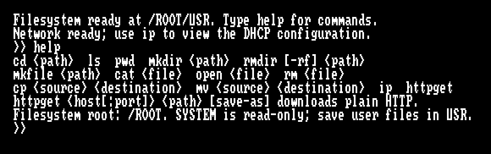
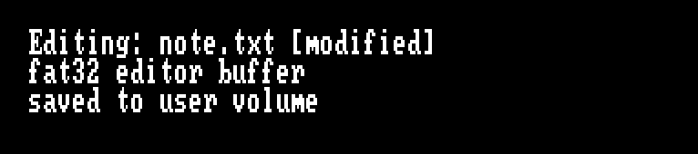
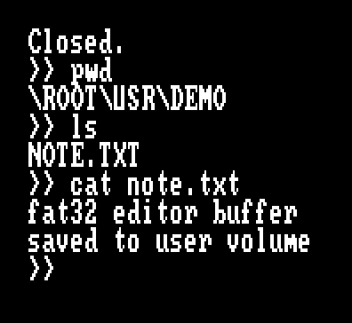
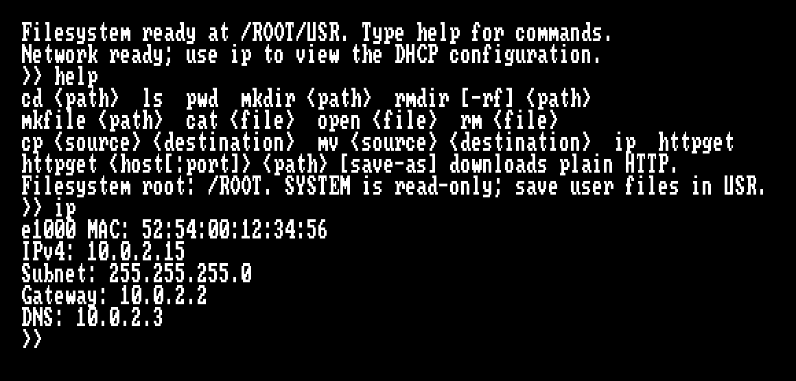
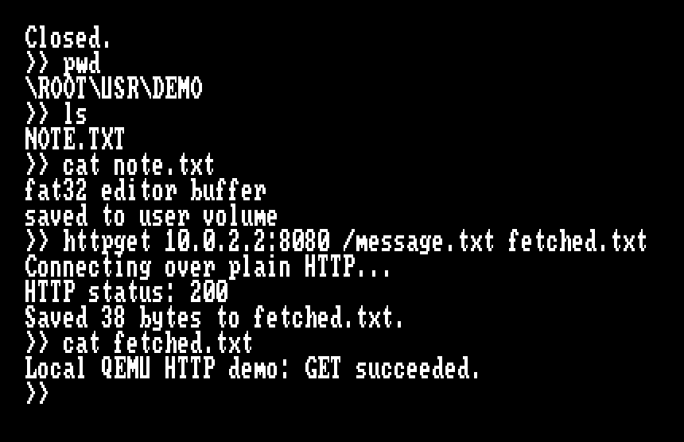

# Daneel's RiTron user guide

**Guides:** [Home](../README.md) · [Build and run](BUILD.md) ·
[Architecture](ARCHITECTURE.md) · [Shell and filesystem](FILESYSTEM.md) ·
[Networking](NETWORKING.md)

This guide is a walkthrough of the current QEMU build, including the limits
that define what each visible feature can do. It assumes the OS has booted and
the shell prompt is visible. To build and launch it, start with the
[build guide](BUILD.md).

## Capture configuration

The feature captures in this guide were taken from the project's bootable ISO
using QEMU with OVMF, the `pc` (i440FX) machine, 256 MiB of guest RAM, an IDE
FAT32 disk, an Intel e1000 adapter, and QEMU user-mode networking. Each guest
session uses a temporary clone of `build/data-disk.img`; the repository's
persistent disk was not modified. The HTTP capture also uses a temporary host
server and test file. Captures come
from the 1280x800 guest framebuffer; the active console region is cropped and
enlarged 2x with nearest-neighbor scaling for readability.

| Capture | Guest operation |
| --- | --- |
| `01-shell-help.png` | `help` |
| `02-network-config.png` | `ip` after DHCP |
| `03-editor.png` | Open `DEMO/NOTE.TXT` and edit the buffer |
| `04-filesystem.png` | List and read the saved file |
| `05-httpget.png` | GET `/message.txt`, save it, and read it back |

## First look

At startup the kernel initializes the framebuffer console and keyboard, then
tries to mount the FAT32 data disk and configure the supported e1000 adapter.
The shell still starts if storage or networking is unavailable; the affected
commands report the problem.



The shell prompt is `>> `. Run `help` to display the command list. A few useful
commands to begin with:

```text
pwd
ls
mkdir NOTES
cd NOTES
pwd
cd ..
```

Paths are relative to the current directory unless they begin with `/`.
`/ROOT` is the virtual filesystem root, and the shell starts in `/ROOT/USR`.
The `/ROOT/SYSTEM` subtree contains system EFI files and is read-only through
the shell.

The console renders glyphs into the UEFI GOP framebuffer. The keyboard path is
PS/2 set-1 scan codes -> IRQ1 -> a 64-slot ring buffer -> the shell polling
loop; one slot distinguishes full from empty, so at most 63 events are
queued. The shell command buffer is 600 bytes including its terminator, with
an eight-command history and a four-token dispatch limit. See
[Architecture](ARCHITECTURE.md) for interrupt and boot details.

## Create and edit a file

`open` opens an existing text file or starts a new unsaved file:

```text
open NOTES/HELLO.TXT
```

Type printable ASCII text in the editor. Its main keys are:

| Key | Action |
| --- | --- |
| **Ctrl+S** | Save the current file. |
| **Ctrl+X** | Close the editor and discard unsaved changes. |
| **Tab** | Insert a tab character. |
| **Arrow keys** | Move the cursor. |
| **Home / End** | Move to the start or end of the current line. |
| **Backspace / Delete** | Remove text before or at the cursor. |



The editor uses a fixed 65,536-byte buffer and writes through the FAT32
filesystem layer. On open, CRLF and CR sequences are normalized to LF; saved
text uses LF. The editor does not implement Unicode input or preserve the
original newline convention. The screenshot's `[Modified]` marker is cleared
after a successful save.

After saving, return to the shell and inspect the file:

```text
cat NOTES/HELLO.TXT
```

Files are limited to 64 KiB, and the editor accepts printable ASCII text. New
files and edits are stored on the persistent data disk. The shell also
supports Up/Down command history, line editing, and Tab completion for
commands and names in the current directory.

### File and directory commands

| Command | Example | Notes |
| --- | --- | --- |
| `ls` | `ls` | Lists the current directory. |
| `cd <path>` | `cd /ROOT/USR/NOTES` | `cd ..` moves up; `cd /` returns to `/ROOT`. |
| `mkdir <path>` | `mkdir NOTES` | Creates a directory, including nested paths. |
| `mkfile <path>` | `mkfile NOTES/EMPTY.TXT` | Creates an empty file. |
| `cat <file>` | `cat NOTES/HELLO.TXT` | Prints text files up to 64 KiB. |
| `cp <source> <destination>` | `cp A.TXT B.TXT` | Copies a regular file; destination must not exist. |
| `mv <source> <destination>` | `mv A.TXT NOTES/A.TXT` | Moves or renames a regular file; destination must not exist. |
| `rm <file>` | `rm NOTES/EMPTY.TXT` | Removes a file. |
| `rmdir <path>` | `rmdir NOTES` | Removes an empty directory. |
| `rmdir -rf <path>` | `rmdir -rf NOTES` | Recursively deletes a directory and its contents. |

Quote paths containing spaces, for example `open "NOTES/MY FILE.TXT"`.
Recursive deletion is permanent. FAT32 is not journaled, so keep backups of
important files; see the [filesystem guide](FILESYSTEM.md) for failure and
recovery details.



The data image is a raw volume with no partition table. The kernel recognizes
it by the FAT32 boot signature, volume label, and volume ID rather than disk
enumeration order. ATA reads and writes are single-sector PIO operations; the
filesystem stages replacement data and flushes before publishing directory
metadata, but FAT32 is not transactional. See the detailed
[filesystem design](FILESYSTEM.md).

## Check networking

The QEMU configuration uses an Intel e1000 adapter and user-mode networking.
Run:

```text
ip
```

The output shows the adapter MAC address and DHCP IPv4 configuration. QEMU
commonly assigns `10.0.2.15`, with gateway `10.0.2.2` and DNS server
`10.0.2.3`; use the values shown by `ip` rather than assuming they are fixed.



### Make a local HTTP request

This test serves a file from the host to the guest; it does not depend on
public Internet access.

1. On the host, change to a directory containing a test file such as
   `index.html`, then start a small HTTP server:

   ```sh
   python3 -m http.server 8080 --bind 0.0.0.0
   ```

   On Windows, use `python` if `python3` is not available.
2. In the OS shell, inspect the QEMU network configuration and fetch the file:

   ```text
   ip
   httpget 10.0.2.2:8080 /index.html index.html
   cat index.html
   ```

`httpget` accepts a hostname or IPv4 address, an optional port (default 80),
an absolute path, and an optional destination filename. It supports plain
HTTP only. Do not send passwords, tokens, or other private data through it.
For timeouts, supported protocols, and parser limits, see
[Networking](NETWORKING.md).



At the ABI boundary, the shell passes the Rust client the host string, port,
path, a 65,536-byte output buffer, status/length pointers, and a PIT-backed
stall callback. The serialized request is limited to 512 bytes and the path
to 400 printable ASCII bytes. Saving is allowed only for a 2xx status; this
is plain HTTP over one synchronous TCP connection, without TLS, redirects,
fragment reassembly, or concurrent sockets.

## Build, persistence, and help

The image at `build/data-disk.img` is a raw 64 MiB FAT32 volume and persists
between QEMU runs. `make disk` updates the system EFI files while preserving
user files. Back up the image before `make clean`, which removes all of
`build/`.

Useful host-side commands:

```sh
make net-test
make disk-test
make verify
```

These validate protocol helpers and disk-image structure; they are not a
complete kernel test suite or proof of physical-hardware compatibility.
If the shell reports that the filesystem is unavailable, check that the data
disk was created with `make disk`. If `ip` reports no DHCP address, check that
QEMU launched with its e1000 user network. The
[architecture guide](ARCHITECTURE.md) documents the supported devices and
important design limits.
